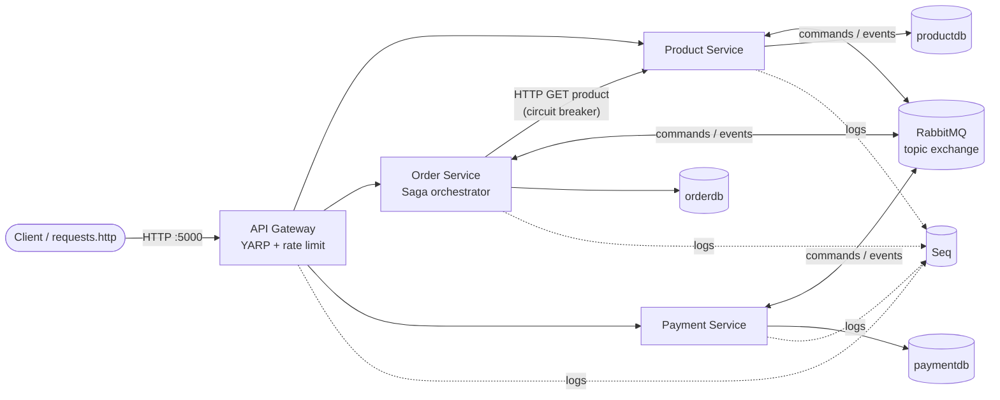
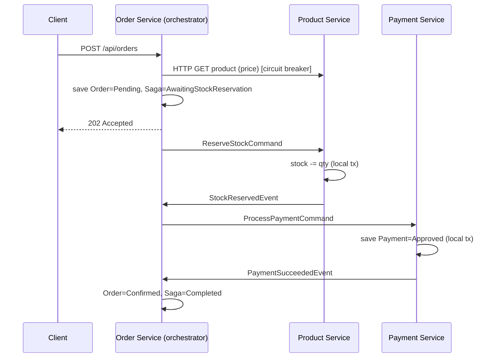
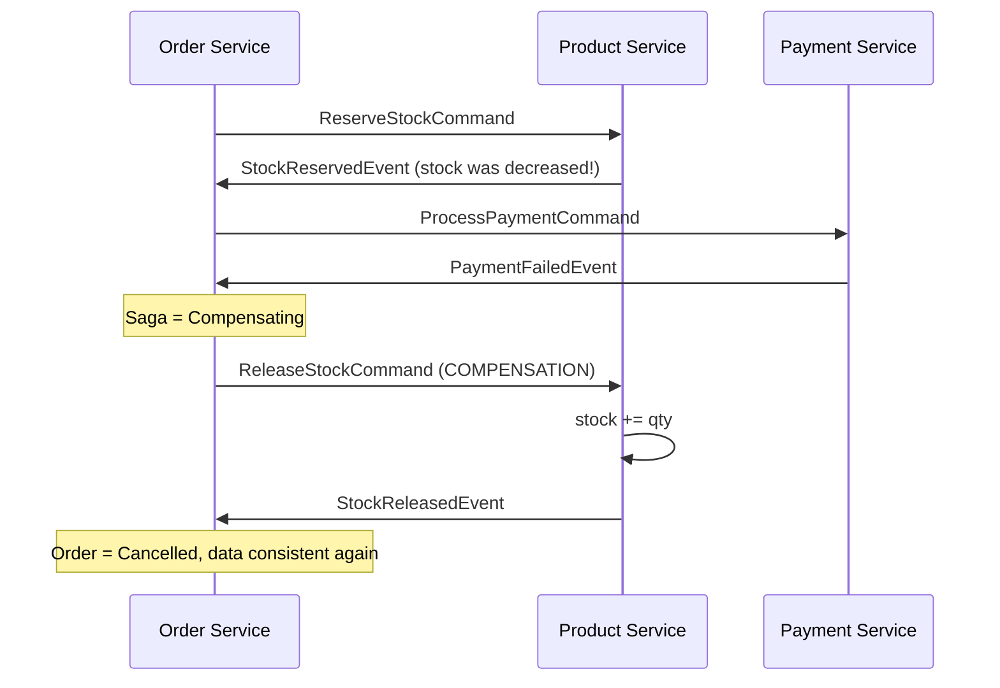

# Ordering System: .NET Microservices Learning Project

A small but complete product-ordering system built to **learn microservices concepts by reading and running the code**, and to serve as a base for **Kubernetes practice**.

| Concept | Technology | Where to look |
|---|---|---|
| API Gateway + rate limiting | YARP | [src/ApiGateway/Program.cs](src/ApiGateway/Program.cs) |
| Asynchronous messaging | RabbitMQ (raw `RabbitMQ.Client` 7) | [src/BuildingBlocks/Messaging/](src/BuildingBlocks/Messaging/) |
| Dead-letter queues, retries, ack/nack | RabbitMQ | [RabbitMqConsumerService.cs](src/BuildingBlocks/Messaging/RabbitMqConsumerService.cs), [RabbitMqTopology.cs](src/BuildingBlocks/Messaging/RabbitMqTopology.cs) |
| Saga (orchestration + compensation) | Custom state machine | [OrderSagaOrchestrator.cs](src/Services/OrderService/Saga/OrderSagaOrchestrator.cs) |
| Circuit breaker + retry + timeout | Polly v8 (`Microsoft.Extensions.Http.Resilience`) | [ProductCatalogClientSetup.cs](src/Services/OrderService/Clients/ProductCatalogClientSetup.cs) |
| Database per service | PostgreSQL + EF Core | each service's `Data/` folder |
| Idempotent consumers | DB checks + saga step guards | the `*Handler.cs` files, `IsExpected()` in the saga |
| Optimistic concurrency | Postgres `xmin` | [Product.cs](src/Services/ProductService/Domain/Product.cs) |
| Centralized structured logging | Serilog → Console + Seq | [LoggingExtensions.cs](src/BuildingBlocks/Observability/LoggingExtensions.cs) |
| Correlation IDs (distributed tracing light) | HTTP header + AMQP property | [CorrelationContext.cs](src/BuildingBlocks/Observability/CorrelationContext.cs) |
| Liveness / readiness probes | ASP.NET Core health checks | [HealthCheckExtensions.cs](src/BuildingBlocks/Health/HealthCheckExtensions.cs) |
| Containerization | Multi-stage Dockerfiles, non-root | [docker/](docker/), [docker-compose.yml](docker-compose.yml) |

---

## 1. Architecture



**Two styles of communication, on purpose:**

* **Synchronous HTTP** (Order → Product): used when we need an answer *right now* (the trusted product price). Risk: if Product Service is down, Order Service suffers too. **Mitigation: circuit breaker.**
* **Asynchronous messaging** (RabbitMQ): used for the order workflow. Services don't need to be up at the same moment; messages wait in durable queues. **Cost: eventual consistency.** The order is `Pending` for a short while, which is why `POST /api/orders` returns **202 Accepted**, not 201.

### Project layout

```
├── docker-compose.yml          # whole system: infra + 4 apps
├── .env                        # credentials used by compose
├── requests.http               # ready-made demo scenarios
├── docker/                     # everything Docker-specific, separate from the application code
│   ├── api-gateway/Dockerfile
│   ├── product-service/Dockerfile
│   ├── order-service/Dockerfile
│   ├── payment-service/Dockerfile
│   ├── web-client/             # Dockerfile (Node build → nginx) + nginx.conf.template
│   └── postgres/init-databases.sql   # creates one database per service
└── src/                        # application code only (no Docker files)
    ├── WebClient/              # Angular 22 frontend
    ├── BuildingBlocks/         # shared library (contracts, messaging, logging, health, db init)
    ├── ApiGateway/             # YARP reverse proxy
    └── Services/
        ├── ProductService/     # catalog + inventory (saga participant)
        ├── OrderService/       # orders + SAGA ORCHESTRATOR + circuit breaker
        └── PaymentService/     # payments (saga participant)
```

---

## 2. Run it

**Requirements:** Docker Desktop. The .NET 10 SDK is only needed to run the services outside Docker.

```bash
docker compose up --build -d
docker compose ps                      # wait until all containers are "running"
docker compose logs -f order-service   # watch the saga
```

| URL | What |
|---|---|
| **http://localhost:4200** | **Web UI (Angular): start here** |
| http://localhost:5000 | API Gateway (the only API entry point) |
| http://localhost:5000/swagger | **Swagger UI for all services** (pick a service in the top-right dropdown) |
| http://localhost:15672 | RabbitMQ management UI (`admin` / `admin`) |
| http://localhost:8081 | Seq log UI (port 5341 receives logs from services started with `dotnet run`) |
| localhost:5432 | PostgreSQL (`postgres` / `postgres`) |

Then open [requests.http](requests.http) and run the scenarios. You need the *REST Client* extension in VS Code; Visual Studio and Rider support `.http` files natively. With curl:

```bash
curl -X POST http://localhost:5000/api/orders/ -H "Content-Type: application/json" \
  -d '{"customerEmail":"alice@example.com","items":[{"productId":"33333333-3333-3333-3333-333333333333","quantity":2}]}'
```

Stop with `docker compose down`. Add `-v` to wipe databases, queues and logs.

**Running a service from your IDE (optional):** start only the infrastructure with `docker compose up -d postgres rabbitmq seq`, then `dotnet run` the services. Their `appsettings.json` already points at `localhost`; ports are 5000 (gateway), 5101 (products), 5102 (orders) and 5103 (payments).

### Web UI (Angular)

```
Browser ──► web-client (nginx :4200) ── /api/* ──► api-gateway:8080 ──► services
              static Angular files        reverse proxy (one origin, so no CORS needed)
```

| Page | What to watch |
|---|---|
| **Shop** | Products with live stock, cart, checkout, and 3 one-click **saga scenarios** |
| **Order tracker** | Polls every second: saga steps (including the **compensation** branch), the saga log, and a link to Seq filtered by the order's correlation id |
| **Orders / Payments** | Data owned by two different services and databases |
| **Circuit breaker lab** | Chaos switch, live circuit state, and test orders with timings (slow retries, then instant fail-fast) |
| **API activity panel** (bottom) | Every HTTP call: status, duration, and the correlation id that the browser created |

Code: [src/WebClient/src/app/](src/WebClient/src/app/). Start with `core/ordering-api.ts`, `core/activity-log.ts` (interceptor), then `pages/order-tracker/`.

**Running the UI with hot reload instead of Docker:** start the backend (`docker compose up -d`), then:

```bash
cd src/WebClient
npm install
npm start          # http://localhost:4200; proxy.conf.json forwards /api to the gateway on :5000
```

### Seed data

| Product | Id | Price | Stock | Use it to demo |
|---|---|---|---|---|
| Wireless Headphones | `3333…` | 129.99 | 200 | happy path |
| Smartphone X | `2222…` | 699 | 100 | circuit breaker |
| Laptop Pro 14 | `1111…` | 1499 | 50 | **payment failure → compensation** (limit is 1000) |
| Limited Edition Watch | `4444…` | 249 | 2 | **out of stock** |

---

## 3. RabbitMQ: how the messaging works

```
 publisher ──(routing key = message class name, e.g. "ReserveStockCommand")──► exchange "ordering.events" (topic)
                                                                                 │ bindings
                       ┌─────────────────────────────────────────────────────────┼──────────────────────────┐
                       ▼                                                         ▼                          ▼
             queue product-service                                    queue order-service          queue payment-service
             ReserveStockCommand, ReleaseStockCommand                 StockReserved..., Payment... ProcessPaymentCommand
                       │  handler failed 3 times → NACK(requeue=false)
                       ▼
             exchange "ordering.dead-letter" ──► queue product-service.dlq   (inspect it in the RabbitMQ UI)
```

Key ideas, all visible in [src/BuildingBlocks/Messaging/](src/BuildingBlocks/Messaging/):

1. **One connection per app, separate channels** for publishing and consuming ([RabbitMqConnection.cs](src/BuildingBlocks/Messaging/RabbitMqConnection.cs)).
2. **Self-declaring topology.** Every service declares the exchange, its own queue, its DLQ and its bindings at startup. Declarations are idempotent ([RabbitMqTopology.cs](src/BuildingBlocks/Messaging/RabbitMqTopology.cs)).
3. **Durability:** durable exchanges and queues, plus `Persistent = true` messages, survive a broker restart.
4. **Publisher confirms:** `PublishAsync` completes only after the broker acknowledges it stored the message ([RabbitMqPublisher.cs](src/BuildingBlocks/Messaging/RabbitMqPublisher.cs)).
5. **Manual ack** (`autoAck: false`): a message is removed only after the handler succeeds. If a pod crashes mid-way, the message is redelivered. This is **at-least-once delivery**.
6. **Retry, then dead-letter:** 3 in-process attempts, then `BasicNack(requeue:false)` routes the message to `<queue>.dlq` so one poison message can't block the queue forever.
7. **Prefetch (QoS)** limits the number of unacked messages per consumer. That's fair load distribution when you scale to several replicas in Kubernetes.
8. **Competing consumers:** run 3 replicas of `product-service` and they share **one** queue; RabbitMQ load-balances messages between them for free.

Adding a handler to a service is one line:

```csharp
builder.Services.AddRabbitMqMessaging(builder.Configuration)
    .AddHandler<ReserveStockCommand, ReserveStockHandler>();
```

---

## 4. The saga pattern

**Problem:** placing an order changes **three databases** (orders, stock, payments) that belong to three services. A normal database transaction can't span them.

**Solution:** split the business transaction into **local transactions**, one per service, chained by messages. If a step fails, run **compensating actions** that semantically undo the earlier steps.

This project uses an **orchestration** saga: [OrderSagaOrchestrator.cs](src/Services/OrderService/Saga/OrderSagaOrchestrator.cs) is the coordinator, and you can read the entire workflow in that one file. The alternative is **choreography**, where each service reacts to the others' events with no central brain. It is more decoupled, but the flow is harder to follow.

### Happy path



### Failure + compensation (payment declined)



### Saga state machine

```
AwaitingStockReservation ──StockReserved──────► AwaitingPayment ──PaymentSucceeded──► Completed
          │                                           │
          └──StockReservationFailed──► Failed         └──PaymentFailed──► Compensating ──StockReleased──► Failed
```

* The saga state is **persisted** in `order_sagas`, so a pod restart doesn't lose it.
* Every step is written to `order_saga_log`. Call `GET /api/orders/{id}/saga` to see the timeline.
* **Idempotency guard:** each handler first checks that the saga is in the step that expects this event. A duplicate is logged and ignored.

---

## 5. The circuit breaker

Order Service calls Product Service over HTTP through this pipeline:

```
request ─► RETRY (2x, exp. backoff + jitter) ─► CIRCUIT BREAKER ─► TIMEOUT (3s) ─► HTTP
```

```
 CLOSED ──(≥50% of ≥5 attempts failed in 30s)──► OPEN ──(20s)──► HALF-OPEN ──trial OK──► CLOSED
   normal                                    fail instantly          1 trial call    └─fail──► OPEN
```

* **Why:** without it, every order request would wait for timeouts on a dead service, threads and connections pile up, and the failure **cascades** into the Order Service and the gateway.
* **Open circuit = fail fast.** `BrokenCircuitException` is thrown without any network call, and the API returns a clean **503** ([OrderEndpoints.cs](src/Services/OrderService/Endpoints/OrderEndpoints.cs)).
* **Live state:** `GET /api/orders/circuit-breaker`.
* Watch the `RETRY`, `CIRCUIT OPENED`, `HALF-OPEN` and `CLOSED` log lines in `docker compose logs -f order-service`.

**Demo:** run scenario 4 in [requests.http](requests.http). Turn chaos on, place 2–3 orders (the circuit opens), turn chaos off, wait 20 seconds, then place an order (half-open → closed).

---

## 6. Logging and correlation

Every log line carries `ServiceName` and `CorrelationId`:

```
[10:21:04 INF] [OrderService] [demo-compensation-001] OrderService.Saga.OrderSagaOrchestrator
      SAGA 5f0e...: AwaitingPayment -> Compensating
```

1. The gateway reads `X-Correlation-Id`, or creates one, and returns it in the response.
2. YARP forwards the header, and `CorrelationIdDelegatingHandler` adds it to service-to-service HTTP calls.
3. The publisher stores it in the AMQP `correlation_id` property, and the consumer restores it.

**Try it:** send scenario 2 with `X-Correlation-Id: demo-compensation-001`, open Seq at http://localhost:8081 and search `CorrelationId = 'demo-compensation-001'`. You'll see the whole saga across all four services in order.

---

## 7. Notes on resilience and data consistency

| Situation | What protects us |
|---|---|
| Same message delivered twice | Idempotent handlers (reservation and payment lookups by `OrderId`, unique index on `payments.OrderId`, saga step guard) |
| Two orders race for the last item | Optimistic concurrency (`xmin`); the loser gets `DbUpdateConcurrencyException` and the consumer retries with fresh data |
| Handler keeps failing | 3 attempts, then the dead-letter queue |
| RabbitMQ/Postgres not ready at startup | Retry loops in `RabbitMqConnection` and `DatabaseInitializer` |
| RabbitMQ restarts | Automatic connection + topology recovery, durable queues, persistent messages |
| Product Service down | Circuit breaker → fast 503 |
| Client floods the API | Gateway rate limiter → 429 |

### Known simplifications (good next steps)

1. **Transactional outbox:** the saga does `SaveChanges()` then `Publish()`. A crash between them leaves the saga stuck. The fix is to write messages to an `outbox` table in the same transaction and have a background worker publish them.
2. **EF migrations** instead of `EnsureCreated()`, run as a Kubernetes **Job** or init container.
3. **Saga timeouts:** a scheduled job that cancels and compensates sagas stuck in one step for more than N minutes.
4. **Authentication:** JWT validation at the gateway (for example Keycloak).
5. **OpenTelemetry** traces and metrics (Jaeger/Tempo + Prometheus/Grafana) as the step up from correlation IDs.
6. **MassTransit:** once you understand the raw RabbitMQ code here, compare it with a framework that does all of this for you.

---

## 8. Getting ready for Kubernetes

The project already follows the conventions Kubernetes expects:

| Already done | Kubernetes equivalent |
|---|---|
| Config via env vars (`ConnectionStrings__OrderDb`, `RabbitMq__Host`, …) | `ConfigMap` + `Secret` → `envFrom` |
| `.env` credentials | `Secret` |
| `/health/live` (process only) | `livenessProbe` |
| `/health/ready` (DB + RabbitMQ) | `readinessProbe` |
| Stateless services (saga state in DB, not memory) | `Deployment` with `replicas: N` |
| Service names = DNS (`product-service:8080`) | `Service` (ClusterIP) with the same names |
| Only the gateway is exposed | Gateway `Service` type `LoadBalancer`/`NodePort`, or an `Ingress` |
| Non-root containers on port 8080 | `securityContext.runAsNonRoot: true` |
| Logs to stdout | `kubectl logs`, plus cluster log collectors |
| Postgres / RabbitMQ volumes | `StatefulSet` + `PersistentVolumeClaim` (or Helm charts / operators) |

Suggested learning path:

1. **Basic:** push the images to a registry, write a `Deployment` + `Service` per app, and use `ConfigMap`/`Secret`.
2. **Intermediate:** probes, resource requests/limits, `StatefulSet` for Postgres/RabbitMQ, an `Ingress` in front of the gateway, and `kubectl scale deployment product-service --replicas=3` to watch competing consumers.
3. **Advanced:** a Helm chart or Kustomize overlays (dev/prod), HPA autoscaling, Network Policies (only the gateway may call the services), a migration `Job`, and a CI/CD pipeline in Azure DevOps that builds the images and deploys to AKS.
